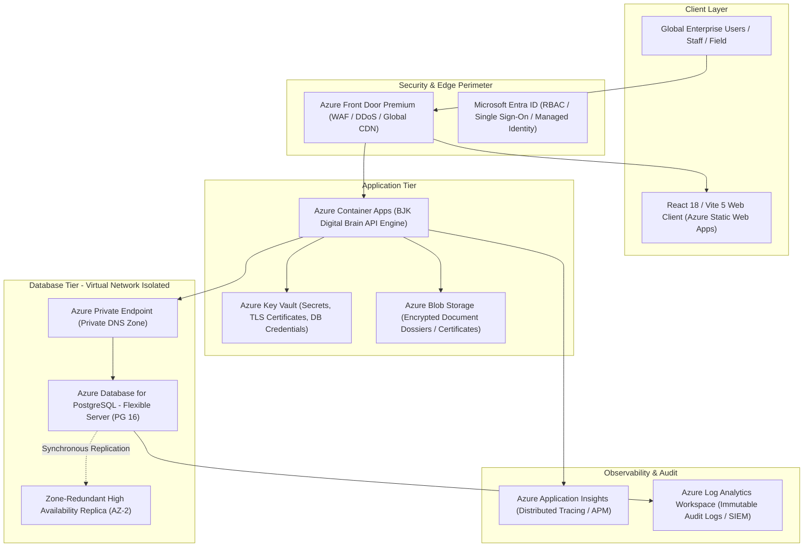

# BJK HEALTHCARE DIGITAL BRAIN — AZURE CLOUD ARCHITECTURE
## Target Infrastructure Specification: PostgreSQL Flexible Server & Enterprise Container Apps

---

### 1. Executive Summary & Architecture Topology

This document specifies the enterprise Azure target architecture for the **BJK Healthcare Digital Brain**. Designed for pharmaceutical manufacturing, GxP compliance (21 CFR Part 11, WHO-GMP), high availability, and multi-region business continuity.

---

### 2. Core Architectural Components

#### 2.1 Compute & Web Layer
- **Frontend Presentation**: **Azure Static Web Apps (Standard Tier)**.
  - Global edge distribution with integrated custom domain management and automated SSL/TLS renewal.
  - Zero server management overhead; instant global cache invalidation upon GitHub Actions deployments.
- **Backend API & Processing**: **Azure Container Apps (Dedicated Workload Profile)**.
  - Serverless micro-scaling: Scales from 2 to 10 instances based on HTTP request concurrency and queue depth.
  - Native integration with Azure Virtual Network (VNet) injection for private database peering.
  - Zero open public IP on database or internal endpoints.

#### 2.2 Database Tier: Azure Database for PostgreSQL Flexible Server
- **Engine Version**: PostgreSQL 16 (Relational, JSONB, native UUIDv4, advanced indexing).
- **Compute Tier**: `General Purpose (D4ds_v5)` — 4 vCores, 16 GiB RAM (expandable to `Memory Optimized E8ds_v5` for high-throughput batching).
- **High Availability**: Zone-Redundant High Availability across two Availability Zones (AZ-1 Primary, AZ-2 Standby) with zero-data-loss synchronous streaming replication and automatic failover in < 60 seconds.
- **Storage Tier**: Premium SSD v2 (Auto-grow enabled, starting at 128 GB, 3,000 IOPS, 125 MB/s throughput).
- **Network Isolation**: Private Access (VNet Integration) via private subnet delegated to `Microsoft.DBforPostgreSQL/flexibleServers`. No public internet exposure.

#### 2.3 Identity, Security & Secrets Management
- **Azure Key Vault**: Stores `DATABASE_URL`, `JWT_SECRET`, encryption keys, and third-party API credentials.
- **Managed Identities**: Container Apps authenticate to Key Vault and Blob Storage using Azure System-Assigned Managed Identity (zero plaintext passwords in environment variables or code).
- **Encryption**:
  - **In-Transit**: TLS 1.3 enforced across all ingress and internal hops.
  - **At-Rest**: Azure Storage Service Encryption with Customer-Managed Keys (CMK) via Key Vault.

#### 2.4 GxP Audit & Observability Tier
- **Application Insights & Log Analytics Workspace**: Centralized telemetry capturing all API latency, HTTP response codes, error rates, and database transaction times.
- **Audit Immutability**: All pharmaceutical system audit events (`audit_logs` table) are synchronized to Azure Log Analytics with immutable WORM (Write Once, Read Many) retention for a minimum of 7 years in compliance with 21 CFR Part 11 requirements.

---

### 3. Connection Pooling & Serverless Sizing

| Metric | Staging / Development | Azure Production Target |
|---|---|---|
| **PostgreSQL SKU** | B1ms (1 vCore, 2 GB) / PGlite | D4ds_v5 (4 vCore, 16 GB) |
| **Max Database Connections** | 50 | 500 (Built-in PgBouncer enabled) |
| **App Pool Size (`DATABASE_POOL_MAX`)** | 5 | 10 per container replica |
| **Ingress Protocol** | HTTP/1.1 | HTTP/2 + TLS 1.3 |
| **PgBouncer Mode** | Off | Transaction Pooling (Port 6432) |
| **Backup Retention** | 7 days | 35 days (Point-in-Time Recovery) |
| **Geo-Redundant Backup** | Disabled | Enabled (Paired Azure Region) |

---

### 4. Cost Optimization & Right-Sizing Summary (Estimated)

*Note: Resource creation is NOT_APPROVED. Estimated estimates provided for capacity planning:*
- Azure Database for PostgreSQL Flexible Server (D4ds_v5, HA, 128GB): ~$290/month
- Azure Container Apps (2-4 Replicas, 1.0 vCPU, 2GB RAM): ~$65/month
- Azure Static Web Apps (Standard): ~$9/month
- Azure Key Vault, Log Analytics & Network Egress: ~$35/month
- **Total Projected Infrastructure Run Rate**: ~$399/month.
